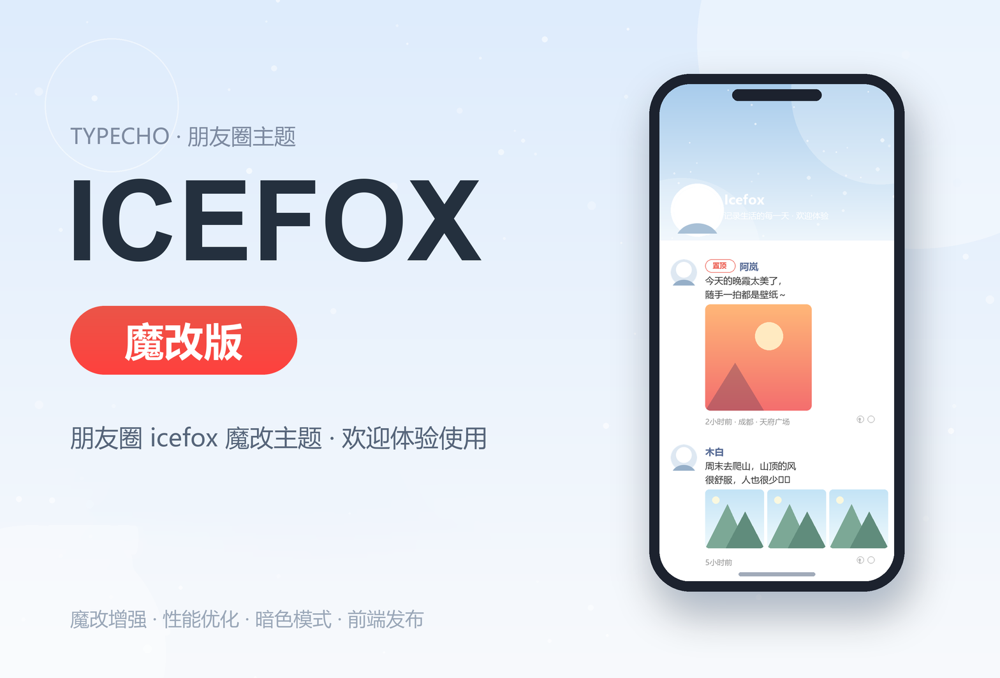

# Icefox 魔改版 · 朋友圈主题（Typecho）

> 版本：**1.0.0** ｜ 作者：**Jeray** ｜ 示例站：<https://hi.jeray.wang/onenote/>

一款把博客做成「朋友圈」的信息流主题。一条动态就是一篇 Typecho 文章，支持九宫格图片、视频、音乐、定位与点赞评论，并且可以在**前台直接发布**，不用进后台。



---

## 特性

- **朋友圈信息流**：卡片式动态，九宫格图片、视频、音乐、定位、广告/置顶标记
- **视频播放**：支持 MP4 直链与 m3u8（HLS），滚动到可视区域自动播放、可设置默认静音
- **前台发布**：有撰写权限的用户点顶栏「+」即可发布动态，图片/视频上传到本站 `usr/uploads`
- **互动**：点赞、评论（支持盖楼回复）、按年月筛选动态
- **全站搜索**：`Ctrl + K` 唤起搜索框
- **暗色 / 亮色**双主题，默认暗色，可一键切换并记住选择
- **顶部网易云音乐播放器**：滚动吸顶、进度条、跨页不中断
- **站点信息**：备案号、公安网备、友情链接、自定义 CSS/JS
- **后台可视化配置**，并支持主题设置的创建备份 / 还原 / 删除
- **性能优化**：字体分片按需加载、重型库延迟加载、PJAX 无刷新跳转、图片懒加载
- **零遥测**：主题不含任何统计上报或回传代码，不采集任何访问数据

---

## 环境要求

| 项目 | 要求 |
| --- | --- |
| Typecho | **1.3.0**（使用了 `Typecho\Common` 命名空间） |
| PHP | **7.2+**，推荐 7.4 / 8.0 / 8.1 |
| 数据库 | MySQL 5.6+ / MariaDB / SQLite 均可 |
| 伪静态 | 可选。未开启时接口会自动改用 `?api=xxx` 形式，功能不受影响 |

无需安装额外 PHP 扩展，Typecho 常规运行环境即可（顶部网易云音乐功能依赖 `curl` 扩展，一般默认已开启）。

---

## 安装

1. 解压后将主题文件夹放到 `usr/themes/` 下，**文件夹名随意**（如 `icefox_mogai`）
2. 登录后台 → 控制台 → 外观 → 找到「icefox魔改版」→ **启用**
3. 点击「设置外观」，按需填写站点信息（见下方配置说明）
4. 如需前台发布，再按下一节创建发布页面
5. 打开首页，强制刷新一次（`Ctrl + F5`）让静态资源生效

> 主题自带中性占位头像，未配置头像时也能正常显示，不会出现破图。

---

## 创建前台发布页

主题的「发布动态」入口需要指向一个独立页面，步骤如下：

1. 后台 → 管理 → **独立页面** → 新建
2. 标题随意（如「发布」），**自定义模板选择「前端发布文章」**
3. 发布后复制该页面地址
4. 回到 设置外观 → **前端发布页地址**，粘贴该地址并保存

完成后，**管理员 / 编辑 / 贡献者**登录后会在顶栏看到发布按钮；未登录访客和普通注册用户看不到（仍可点赞、评论）。

---

## 上传设置（发布图片/视频前必看）

前台发布走 Typecho 原生上传通道，文件保存在网站服务器的 `usr/uploads/` 目录，可在后台「管理 → 附件」查看和删除。

**① 允许上传的类型**

后台 → 设置 → 基本 → 允许上传的文件类型，补充：

```
mp4 m4v mov webm m3u8 ts
```

**② 调整服务器上传上限**

主题前端已按 **200MB** 做预检提示，实际能传多大取决于服务器：

- PHP：`upload_max_filesize`、`post_max_size`
- Nginx：`client_max_body_size`（Apache 为 `LimitRequestBody`）

两者都要大于目标文件体积，否则会提示 413 错误。

---

## 后台设置项

路径：控制台 → 外观 → 设置外观

| 设置项 | 说明 | 默认 |
| --- | --- | --- |
| 站点顶部背景图 | 顶部头图 URL，建议 1200px 宽以上 | 空（纯色渐变） |
| 站点顶部用户头像 | 顶栏大头像 URL；留空使用主题内置占位图 | 空 |
| 文章侧用户头像 | 信息流卡片上的作者头像；留空按作者邮箱取头像源 | 空 |
| 顶部用户头像旁名称 | 头像旁显示的名字 | 空 |
| 顶部头像旁名称跳转地址 | 点击名字跳转的链接 | 空 |
| 置顶文章 | 文章 ID，多个用 `\|\|` 分隔，如 `3 \|\| 7 \|\| 12` | 空 |
| 备案号 | 如「京ICP备00000001号」 | 空 |
| 公安网备号 | 格式：`网备号 \|\| 跳转地址` | 空 |
| 是否开启可视范围内视频自动播放 | 滚动到视口自动播放、移出自动暂停 | 是 |
| 是否默认播放视频 | 开启上项后本项失效 | 是 |
| 是否默认静音播放视频 | 建议保持「是」，否则多数浏览器会拦截自动播放 | 是 |
| 主题左侧头像源 | 头像接口前缀，留空为 `https://cravatar.cn/avatar/` | 空 |
| 默认主题配色 | 暗色 / 亮色 | 暗色 |
| 是否启用顶部网易云音乐 | 顶栏音乐播放器开关 | 是 |
| 顶部网易云音乐歌曲列表 | 每行一首：`歌曲ID \|\| 封面图地址` | 空 |
| 友情链接 | 每行一个：`logo \|\| 名称 \|\| 链接` | 空 |
| 前端发布页地址 | 见「创建前台发布页」 | 空 |
| 全局自定义 JavaScript | 直接写代码，不用带 `<script>` 标签 | 空 |
| 全局自定义 CSS | 直接写样式，不用带 `<style>` 标签 | 空 |

> 配置页右下角提供「创建备份 / 还原备份 / 删除备份」，改坏了可一键回滚（备份存在数据库 `options` 表中）。

---

## 文章自定义字段

在「写文章」页面下方，可设置这条动态的附加信息：

| 字段 | 作用 |
| --- | --- |
| 朋友圈视频 | 视频地址，MP4 直链或 m3u8；填写后优先展示播放器 |
| 朋友圈图片 | 图片地址，前台发布会自动填充；后台写文章时直接在正文插图即可自动识别为九宫格 |
| 发布定位 | 如「成都市·天府广场」 |
| 定位跳转地址 | 点击定位跳转的地图链接 |
| 是否是广告 | 是 / 不是，标记为广告的卡片会显示「广告」徽章 |
| 插入音乐 | 格式：`歌曲名称 \|\| 专辑名称 \|\| 播放地址 \|\| 封面图地址` |

---

## 常见问题

**Q：顶部头像 / 卡片头像不显示？**
检查后台填写的 URL 是否可访问、是否为 `https`（`http` 资源在 HTTPS 站点会被浏览器拦截）。留空时会回退到主题内置占位图或头像源。

**Q：视频不自动播放？**
浏览器策略限制：**带声音的视频不允许无用户手势自动播放**。解决方案：把「是否默认静音播放视频」设为「是」。另外「是否开启可视范围内视频自动播放」设为「是」时，滚动到视口内才会开始播放。

**Q：上传视频提示 413 / 上传失败？**
服务器限制，参见「上传设置」一节调整 PHP 与 Nginx 的上限。

**Q：点赞报错或无效？**
主题会在首次点赞时自动给 `contents` 表追加 `agree`、`agree_users` 两个字段，请确保数据库账号有 `ALTER` 权限。

**Q：后台设置页样式错乱？**
多为浏览器缓存，强制刷新；或确认主题文件夹内 `assets/css/admin.css` 存在。

**Q：换域名后样式/图片 404？**
后台 → 设置 → 基本，把站点地址改为新域名；主题内所有资源均使用相对主题路径，无需改代码。

**Q：能不能只做博客、不用朋友圈样式？**
可以，信息流本身就是文章列表；图片、视频、定位等字段都是可选的，不填即为纯文字动态。

---

## 目录结构

```
icefox_mogai/
├── assets/            静态资源（css / js / 图片 / 字体分片）
│   ├── css/style.css  主题样式
│   ├── js/icefox.js   前端交互主脚本
│   ├── js/edit.js     前台发布逻辑
│   └── fonts/         内置字体（HarmonyOS Sans，分片加载）
├── components/        页面组件（头部、卡片、评论区、弹窗、页脚等）
├── core/              PHP 核心（接口、文章、评论方法）
├── edit.php           前台发布页模板
├── functions.php      主题配置与钩子
├── index.php          首页 / 信息流
├── post.php           动态详情
├── page.php           独立页面
├── archive.php        分类 / 标签 / 归档
├── 404.php            404 页面
├── screenshot.png     主题预览图
└── README.md          本文档
```

---

## 隐私说明

- **不含任何统计代码、埋点或数据回传**，不会向作者或第三方上报站点信息、访问记录
- 仅在以下两种情况会请求**外部服务**，且均可在后台关闭或替换：
  - 头像源 `cravatar.cn`（后台「主题左侧头像源」可改为自建地址）
  - 网易云音乐歌曲信息（仅「启用顶部网易云音乐」且配置了歌曲时）
- 所有文章、图片、视频、用户数据均保存在你自己的服务器与数据库内

---

## 版本记录

**1.0.0**（首个公开发行版）
- 朋友圈信息流、九宫格图片、视频播放（MP4 / m3u8）
- 前台发布动态，上传走 Typecho 原生机制，文件存本站 `usr/uploads`
- 点赞、评论、搜索、时间筛选
- 暗色/亮色主题、顶部音乐播放器、友链、备案信息
- 后台可视化配置 + 设置备份还原
- 移除一切个人化配置与统计代码，可直接公开分发

---

## 致谢与许可

- 原主题 **Icefox** © [小胖脸](https://github.com/xiaopanglian/icefox)，感谢原作者开源
- 本魔改版由 [Jeray](https://hi.jeray.wang/) 在原作者基础上二次修改
- 内置 **HarmonyOS Sans** 字体，版权归华为，允许免费商用
- 使用的第三方前端库（jQuery、Alpine.js、Plyr、Viewer.js、hls.js 等）版权归各自作者所有

二次修改或再分发时，请保留原作者与本魔改版的署名信息。
